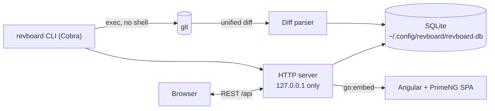

# Git-Review-Board (`revboard`)

A single-binary tool for **large, multi-day code reviews** of git diffs.

`revboard` runs a `git diff` (or `git show`) command and stores the result as a *review session* in a
central SQLite database. It then opens a local web UI where you:

- navigate the changeset as a **file tree** (search, filters, folder progress),
- mark **hunks** or whole **files/folders** as *Reviewed* or *Needs attention*,
- **pin** files you want to come back to,
- keep **private notes** on lines, files or the whole session,
- move with **keyboard shortcuts** (`j`/`k`, `r`, `n`, `u`…).

Close the browser, come back days later with `revboard review resume`, and everything is exactly where
you left it. One database (`~/.config/revboard/revboard.db`) serves all your repositories, and you can switch
between projects from the CLI.

```
revboard review start "git diff dev feat/oai-article-16 -- ':(exclude)*.md'"
```

---

## Contents

- [Installation](#installation)
- [Quick start](#quick-start)
- [CLI reference](#cli-reference)
- [The web UI](#the-web-ui)
- [How it works](#how-it-works)
- [Development](#development)
- [Documentation](#documentation)

## Installation

### Requirements

| To… | You need |
|---|---|
| run `revboard` | `git` in your `PATH`, and a browser |
| build `revboard` | Go ≥ 1.26, Node.js ≥ 22 with npm, `make` |

The resulting binary is static (no CGO; SQLite is the pure-Go `modernc.org/sqlite`) and embeds the
web application, so you can copy it anywhere.

### Build from source

```bash
make build            # npm ci + ng build + go build  →  ./revboard
sudo cp revboard /usr/local/bin/    # or: make install  (→ $GOBIN or ~/go/bin)
revboard --help
```

Cross-compiling works out of the box, e.g. `GOOS=darwin GOARCH=arm64 make build`.

## Quick start

```bash
cd ~/src/my-api

# 1. Capture a diff and open it in the browser
revboard review start "git diff dev feat/oai-article-16 -- ':(exclude)*.md'"
#   Created review session #1 "diff dev feat/oai-article-16" in project "my-api"
#     42 files, 187 hunks — 0/187 hunks reviewed
#   revboard is running at http://127.0.0.1:41537/sessions/1
#   Press Ctrl+C to stop.

# 2. Review in the browser… then Ctrl+C. Everything is saved as you go.

# 3. Days later, from anywhere:
revboard status                 # progress of the current project
revboard review resume          # re-opens the last session of the current project

# 4. Several repositories?
revboard project list
revboard project switch billing
revboard review resume
```

## CLI reference

Every command has detailed help with examples: `revboard --help`, `revboard review start --help`, …

```
revboard review start <git command>   Capture a diff as a new session and open it
revboard review resume [id]           Re-open a session (default: last one of the current project)
revboard review list                  List sessions (--all-projects, --archived)
revboard review refresh [id]          Re-run the git command, keep statuses of unchanged hunks
revboard review rename <id> <name>    Rename a session
revboard review exclude [rule...]     List / add exclusion rules (--remove, --clear, -s <id>)
revboard review commits [id]          Commits covered by the session (--path <file>)
revboard review notes [id]            All notes with their code excerpt (--markdown)
revboard review archive <id>          Hide a finished session (--undo to re-activate)
revboard review delete <id>           Delete a session and its notes (--yes to skip confirmation)

revboard project list                 Projects (* = current) with their active reviews
revboard project switch <name|id>     Make a project the current one
revboard project rename <name|id> <new-name>
revboard project remove <name|id>     Forget a project and its sessions (the repository is untouched)

revboard status                       Current project and progress of its sessions
revboard serve                        Open the dashboard of all projects and sessions
revboard version
```

**Global flags**

| Flag | Description |
|---|---|
| `--db <path>` | Database file. Default: `$REVBOARD_DB`, else `$XDG_CONFIG_HOME/revboard/revboard.db`, else `~/.config/revboard/revboard.db` |
| `-P, --project <name\|id>` | Project to use instead of the current one |

**Server flags** (`review start`, `review resume`, `serve`)

| Flag | Description |
|---|---|
| `--port <n>` | Port to listen on (default `0`: a free port is picked) |
| `--addr <ip>` | Loopback address (default `127.0.0.1`; non-loopback addresses are refused) |
| `--no-open` | Do not open the browser, just print the URL |

`review start` also accepts `--name/-n` (session name) and `--no-serve` (create the session only).

### Writing the git command

- Quote the whole command, quoting it as you would in a shell:
  `revboard review start "git diff main...HEAD -- src/ ':(exclude)*.snap'"`
- Or pass it unquoted after `--`: `revboard review start -- git diff --cached`
- The leading `git` is optional: `revboard review start "show HEAD~2"`
- Only `git diff` and `git show` are accepted. Options that change the output format (`--stat`,
  `--name-only`, `--word-diff`, …) are refused because revboard needs a patch.
- Your git configuration cannot break parsing: revboard adds `--no-color --no-ext-diff
  --src-prefix=a/ --dst-prefix=b/` and `-c core.quotePath=false`.
- The command runs in the directory where you typed it (pathspecs are relative to it), and that
  directory is reused by `review refresh`.

### Which project is "current"?

Commands that need a project use, in this order: `--project`, the project selected with
`revboard project switch` (or by the last `review start`/`resume`), then the repository containing the
working directory.

### Exit codes

`0` success · `1` error · `2` invalid usage.

## The web UI

| Area | What you can do |
|---|---|
| **Dashboard** (`/`) | All projects and sessions with progress, open, archive, delete |
| **Toolbar** | Session name (hover → pencil or double-click to **rename**) and git command, overall progress (hunks, files, attention, excluded), **Unified / Split** diff switch, **Colors / Collapse reviewed** view options, **excluded files**, **commits**, session notes, **refresh** (re-runs git), shortcut help |
| **File tree** | Search, filter (to review / needs attention / reviewed / pinned / with notes / excluded), pinned section, per-folder progress. Hover a folder to mark all of its files reviewed, reset them, or **exclude the folder** |
| **Diff** | Unified or side-by-side. Per-file actions (Reviewed, Needs attention, Reset, Pin, Note, **History**, **Exclude**), per-hunk actions in each hunk header, click a **line number** to add a note on that line |
| **Dashboard** | Open, **rename**, archive or delete any session |

Status rules: setting a file's status applies it to all its hunks; a file is *Reviewed* when all its
hunks are, and *Needs attention* as soon as one hunk is.

### Keyboard shortcuts

| Key | Action |
|---|---|
| `j` / `k` | Next / previous hunk (continues into the next/previous file) |
| `n` / `p` | Next / previous file |
| `u` | Jump to the next file that is not reviewed |
| `r` | Mark hunk reviewed **and move to the next one** |
| `a` | Mark hunk "needs attention" |
| `x` | Reset hunk |
| `R` / `A` / `X` | Same for the whole file (`R` also moves to the next file) |
| `s` | Pin / unpin file |
| `c` | Add a note on the file |
| `N` | All notes (session, file and line notes with their code) |
| `z` | Toggle "collapse reviewed hunks" |
| `v` | Switch unified / split diff |
| `h` | Toggle syntax highlighting |
| `l` / `L` | Commits of the review / commits touching the current file |
| `e` | Excluded files |
| `/` | Search files |
| `?` | Help |

In a note editor: `Ctrl+Enter` saves, `Esc` cancels.

### Syntax highlighting (experimental)

Diff lines are coloured with [highlight.js](https://highlightjs.org/) for about 25 languages
(Go, TypeScript/JavaScript, Python, Java, Kotlin, C/C++, C#, Rust, PHP, Ruby, Swift, SQL, shell,
HTML/XML, CSS/SCSS/Less, JSON, YAML, Markdown, Dockerfile, Makefile, INI/TOML…), detected from the
file extension. The palette button in the toolbar (or `h`) turns it off; the choice is saved per
session.

Each side of a hunk (old: context + deleted lines, new: context + added lines) is highlighted as
one block, so comments and strings spanning several lines keep their colours. A hunk starts in the
middle of a file, so a construct opened *before* the hunk (e.g. a long block comment) may be
coloured incorrectly. Hunks over 3 000 lines and minified lines (over 2 000 characters) are not
highlighted.

### Notes

Click a **line number** in the diff to attach a private note to that line (old side for deleted
lines, new side otherwise). Hovering a line number turns it into a comment icon. A line carrying
a note keeps its colours and gets a yellow left border, with a yellow comment icon in place of its
line number. `c` adds a note on the
whole file, and the *Notes* drawer (`N`) holds the session notes.

**Notes and statuses.** A note is a request for a change, so:

- adding a line note marks its hunk *needs attention*; adding a file note marks the file
  *needs attention* (it stays so while the file note exists). Deleting a note does not change any
  status;
- a reviewed hunk or file holds no note: marking a hunk, a file or a folder *reviewed* while it
  has notes asks for confirmation and then deletes those notes.

The *Notes* drawer also lists **every note of the review**, grouped by file. Each line note is
shown with its whole hunk, scrolled to the noted line, which is marked. *Go to line* opens the file,
expands the hunk if it was collapsed, scrolls to the line and highlights it. A filter box searches
note texts and paths. Notes whose line disappeared after a refresh are marked *outdated*.

**Exporting notes for an LLM.** Every note has an *Export* checkbox in the *Notes* drawer
(checked by default; *All* / *None* change them all). *Copy as Markdown* copies a structured
document with the checked notes: repository root, git command and commit range, then for each
note the file path, line (new or previous version), the noted line, the request and a diff
excerpt with the noted line marked. Paste it into an LLM to have the requested changes
implemented, or into a pull request.

From the terminal:

```bash
revboard review notes --markdown            # same export (checked notes; --all for every note)
revboard review notes                       # plain text, noted lines marked with ">"
revboard review notes --context 0           # whole hunks instead of 3 lines around the note
```

### Excluding files

Hide generated files, lock files, docs… from a review without re-capturing it. Rules belong to
the session and can be changed at any time. Excluded files disappear from the tree and the
navigation and are not counted in the progress. Their statuses and notes are kept, and the
*Excluded* tree filter lists them.

| Rule | Excludes |
|---|---|
| `*.md` | every `.md` file, at any depth |
| `docs/` | every directory named `docs` |
| `src/gen/` | that directory (a rule containing a slash starts at the repository root) |
| `**/*.snap` | `**` matches any number of directories |
| `!docs/keep.md` | re-includes a file excluded by an earlier rule (the last matching rule wins) |

```bash
revboard review exclude '*.lock' 'docs/' '**/__snapshots__/'
revboard review exclude --remove 'docs/'
revboard review exclude            # list the rules
```

In the UI: toolbar *Excluded files* button (`e`), the eye icon shown when hovering a folder, or
the *Exclude / Include* toggle of a file header. Including a file excluded by a broader rule (e.g.
`*.lock`) adds a `!path` rule for it.

> Exclusion rules filter a captured session. To keep files out of the capture itself, use a git
> pathspec in the command: `"git diff main feat -- ':(exclude)*.md'"`.

### Inspecting commits

The *Commits* drawer (`l`) lists the commits covered by the review, read live from the
repository: `A..B` for `git diff A B` or `git diff A...B`, `A..HEAD` for `git diff A`, the commit
itself for `git show`. Expand a commit to see its message and changed files, then click a file to
open it in the review. *History* (`L`, or the clock icon of a file) lists only the commits that
touched the current file. The CLI equivalent is `revboard review commits [--path file]`.

### Refreshing a review

When the branch moves (new commits after your first pass), run `revboard review refresh` or click the
refresh button. The diff is replaced, and:

- hunks whose content is unchanged **keep their status**; new or modified hunks become unreviewed,
- pins are kept,
- notes are kept. A line note whose line is no longer in the diff is listed as *outdated* at the
  top of its file.

## How it works



- **Snapshot**: the diff is stored as files and hunks (raw hunk text plus a content hash), so a
  session always shows what you captured, even if the branch changes. Use *refresh* to update it.
- **Lazy loading**: opening a session only loads the file list and statuses. A file's lines are
  fetched when you select it.
- **Fine-grained reactivity**: each hunk and file status is its own Angular signal, and the lines
  live in a child component whose input never changes. Marking a 1,000-line file reviewed
  therefore updates a few hunk headers, not 1,000 rows. See
  [SPEC §11.4](docs/SPEC.md#114-marking-a-1-000-line-file-as-reviewed).
- **Security**: the server only listens on loopback and rejects non-loopback `Host` headers
  (DNS rebinding). Every API call needs an `X-GRB-Client` header, which other web pages cannot send
  without a CORS pre-flight, and revboard never approves one. Git is run with an argument list, never
  through a shell.

Measured on a 3,000-file / 9,000-hunk diff: capture 0.4 s, session load 46 ms, first render 0.6 s,
"mark file reviewed + next file" about 15 ms.

### Browser opening

`revboard` uses `open` (macOS), `rundll32` (Windows), `wslview` / `explorer.exe` (WSL) or `xdg-open`
(Linux). Set `REVBOARD_BROWSER` to override it, e.g. `REVBOARD_BROWSER="firefox --new-tab"`. Use `--no-open`
to just get the URL.

## Development

```
revboard/
├── main.go                 entry point
├── internal/
│   ├── cli/                Cobra commands
│   ├── diff/               unified diff parser (AST)
│   ├── gitx/               git command validation & execution, commit log
│   ├── exclude/            exclusion rule matcher
│   ├── store/              SQLite store, migrations (store/migrations/*.sql)
│   ├── review/             start / refresh use-cases
│   ├── server/             REST API, guards, SPA serving
│   ├── browser/            open URLs (Linux, macOS, Windows, WSL)
│   └── webui/              go:embed of the built UI (dist/ is generated)
├── web/                    Angular 22 workspace (output → internal/webui/dist)
└── docs/                   specification & implementation plan
```

### Common tasks

```bash
make test        # go vet + go test + Angular unit tests
make test-go     # Go only (works without Node.js thanks to a placeholder UI)
make build       # full build
make clean
```

### Live UI development

Run the API and the Angular dev server side by side:

```bash
make dev-api     # terminal 1: revboard serve on :7777 (uses your real database, or set REVBOARD_DB)
make dev-web     # terminal 2: http://localhost:4200, /api proxied to :7777
```

Use a throwaway database while developing: `REVBOARD_DB=/tmp/revboard-dev.db make dev-api`.

### Database

The schema lives in `internal/store/migrations/`. Migrations are embedded and applied
automatically at startup. Add a file `000N_description.sql` to change the schema. To inspect the
data: `sqlite3 ~/.config/revboard/revboard.db`.

## Documentation

- [docs/SPEC.md](docs/SPEC.md): requirements, architecture, CLI, database schema, data models,
  REST API, state management strategy.
- [docs/IMPLEMENTATION_PLAN.md](docs/IMPLEMENTATION_PLAN.md): phases and risks.
