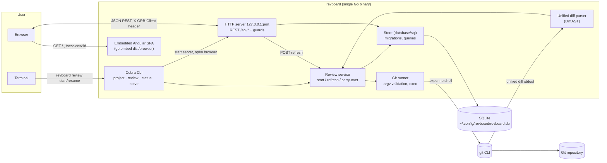
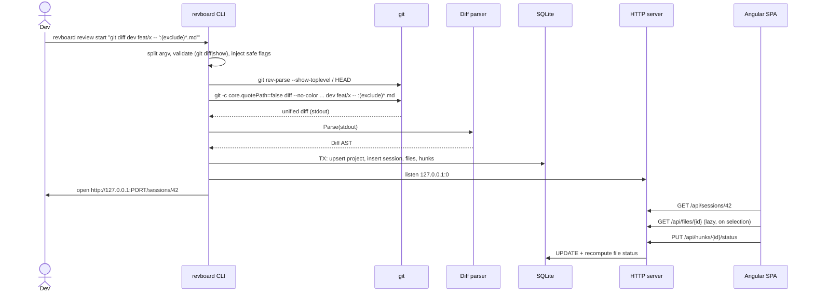

# Git-Review-Board (revboard) — Software Requirements Specification & Technical Design

| | |
|---|---|
| Status | Approved for implementation |
| Version | 1.1 (rename, exclusions, commits, split diff) |
| Date | 2026-10-09 |
| Scope | Local, single-user developer tool. No network services besides a loopback HTTP server. |

---

## 1. Problem statement

Large code reviews (hundreds of files, thousands of hunks, often spread over several repositories)
do not fit in a terminal pager. `git diff` / `delta` give no **persistence** (what did I already
look at?), no **spatial navigation** (tree of the changeset, jump to next unreviewed hunk) and no
**private notes**. revboard captures a diff once, stores it as a reviewable snapshot in a central SQLite
database and serves a local web UI to work through it, across days and across projects.

## 2. Goals and non-goals

### Goals
- **G1** Single static binary (`revboard`) — CLI, HTTP server and UI included (`go:embed`).
- **G2** Capture any `git diff` / `git show` invocation as an immutable *review session* snapshot.
- **G3** Track review progress at **hunk** and **file** granularity: `unreviewed`, `reviewed`, `needs_attention`.
- **G4** Private notes: session-level, file-level and line-level.
- **G5** Pins (bookmarked files) and UI state (selected file, filters) restored on resume.
- **G6** Central database (`~/.config/revboard/revboard.db`) shared by all repositories; switch project context from the CLI.
- **G7** Stay fluid on 1 000+ files / 10 000+ hunks diffs.

### Non-goals (v1)
- Posting comments to GitHub/GitLab, multi-user collaboration, authentication.
- Syntax highlighting, intra-line (word) diff, combined diffs of merge commits (`diff --cc`).
- Editing code from the UI.

## 3. Glossary

| Term | Meaning |
|---|---|
| **Project** | A git repository registered in revboard, identified by its absolute top-level path. |
| **Current project** | Project used by CLI commands when `--project` is not given. Set by `project switch` and by `review start`. |
| **Session** | One captured diff (git command + snapshot of its parsed output) plus all review state attached to it. |
| **File** | One file entry of a diff (`diff --git` section). |
| **Hunk** | One `@@ … @@` block of a file. Smallest unit that carries a review status. |
| **Note / comment** | Private text attached to a session, a file, or a line (`side` + `line` number). |

## 4. Functional requirements

| ID | Requirement |
|---|---|
| FR-1 | `revboard review start "<git command>"` runs the git command (no shell), parses the unified diff and stores it as a new session for the repository containing the working directory. |
| FR-2 | Only `git diff` and `git show` are accepted. revboard forces `--no-color --no-ext-diff --src-prefix=a/ --dst-prefix=b/` and `-c core.quotePath=false` so the output is machine-parsable whatever the user's git config is. |
| FR-3 | After start/resume, a loopback HTTP server is started and the default browser opens on the session page (unless `--no-open`). The server runs until `Ctrl+C`. |
| FR-4 | The UI shows a file tree (with status icons, +/- counts, filter, search), and the diff of the selected file with hunks. |
| FR-5 | The user can set the status of a hunk or of a whole file (`unreviewed`, `reviewed`, `needs_attention`). Setting a file status cascades to all of its hunks. Setting a hunk status recomputes the file status (see §8.3). |
| FR-6 | The user can add/edit/delete notes on a session, a file, or a specific line (old or new side). |
| FR-7 | The user can pin/unpin files; pinned files are listed in a dedicated section above the tree. |
| FR-8 | UI state (selected file, filter, "collapse reviewed hunks") is persisted per session. |
| FR-9 | `revboard review resume [id]` re-opens a session exactly as it was left. Without id: the most recently opened active session of the current project. |
| FR-10 | `revboard review refresh [id]` (and a UI button) re-runs the stored git command and replaces the snapshot, **carrying over** statuses of unchanged hunks (same path + same content hash), pins, and notes (anchored by path/side/line). |
| FR-11 | `revboard project list` / `switch` / `rename` / `remove` manage projects; `revboard review list` / `archive` / `delete` manage sessions; `revboard status` prints progress. |
| FR-12 | Every command supports `--help` with examples. |
| FR-13 | A session can be renamed (`revboard review rename`, toolbar title, dashboard). |
| FR-14 | A session has **exclusion rules** (gitignore-like patterns, §8.5). Excluded files are hidden from the tree and the navigation and are not counted in the progress; their statuses, pins and notes are kept. Rules are managed with `revboard review exclude`, the toolbar dialog, or the "exclude" actions of a file or folder. |
| FR-15 | The commits covered by a session (and the commits touching one file) can be inspected: hash, author, date, message, changed files. They are read live from git (§8.6). |
| FR-16 | The diff can be displayed **unified** or **split** (side by side); the choice is persisted per session. |
| FR-18 | Adding a line note marks its hunk *needs attention*; a file note marks its file *needs attention* (kept while the file note exists). Deleting a note does not change statuses. |
| FR-19 | A reviewed hunk/file holds no note: marking reviewed an item with notes requires a confirmation and deletes its notes (hunk: line notes on its lines; file/folder: all notes of the files). The API refuses with `409 {noteCount}` unless `deleteNotes: true`. |
| FR-20 | Each note has an *export* flag (default true). The checked notes are exported as Markdown for an LLM or a developer to implement them (UI *Copy as Markdown*, `review notes --markdown`, `GET /api/sessions/{id}/notes/export`). |
| FR-17 | All notes can be retrieved in one place (UI *Notes* drawer, `revboard review notes [--markdown]`), each line note with its whole hunk (scrolled to the noted line, which is marked; the CLI prints `--context` lines around it, default 3); "go to line" opens the file, expands the hunk and highlights the line in the diff. |

## 5. Non-functional requirements

| ID | Requirement |
|---|---|
| NFR-1 | **Single binary, no CGO**: SQLite through `modernc.org/sqlite` (pure Go) → trivially cross-compiled. |
| NFR-2 | **Security**: server binds to `127.0.0.1` only; rejects requests whose `Host` is not loopback (DNS-rebinding protection); every `/api` request must carry the `X-GRB-Client: web` header, which a cross-origin page cannot send without a CORS pre-flight that revboard never approves (CSRF protection). Git is executed with `exec.Command` (argv, no shell). |
| NFR-3 | **Performance**: session open (file list only, no hunk bodies) < 200 ms for 5 000 files; file diff loaded lazily on selection; status change round-trip < 50 ms; UI update for "mark 1 000-line file reviewed" touches O(hunks) bindings, not O(lines) (§11). |
| NFR-4 | **Durability**: SQLite WAL, foreign keys on, all multi-row writes in a transaction; schema versioned with embedded migrations. |
| NFR-5 | **Portability**: Linux, macOS, Windows, WSL (browser opened through `wslview`/`explorer.exe`). |
| NFR-6 | All code comments, SQL and identifiers in English. |

## 6. System architecture



### 6.1 Sequence — start a review



### 6.2 Source layout

```
revboard/
├── main.go                     # entry point → internal/cli.Execute()
├── internal/
│   ├── cli/                    # Cobra commands (root, project, review, status, serve, version)
│   ├── config/                 # DB path resolution (flag > REVBOARD_DB > XDG_CONFIG_HOME > ~/.config)
│   ├── diff/                   # Unified diff parser + Diff AST (pure, heavily unit tested)
│   ├── gitx/                   # Command splitting/validation, git execution, repo discovery, commit log
│   ├── exclude/                # Exclusion rule matcher (gitignore-like)
│   ├── store/                  # SQLite access, embedded migrations, queries, DTOs
│   ├── review/                 # Use-cases: StartSession, RefreshSession (carry-over)
│   ├── server/                 # net/http server, REST handlers, guards, SPA fallback
│   ├── browser/                # Cross-platform "open URL" (incl. WSL)
│   └── webui/                  # go:embed of the built Angular app (dist/browser) + placeholder page
├── web/                        # Angular 22 + PrimeNG 22 workspace (build output → internal/webui/dist)
├── docs/                       # This spec + implementation plan
└── Makefile
```

## 7. CLI command structure

Global (persistent) flags:

| Flag | Env | Default | Purpose |
|---|---|---|---|
| `--db <path>` | `REVBOARD_DB` | `$XDG_CONFIG_HOME/revboard/revboard.db` or `~/.config/revboard/revboard.db` | Database file |
| `-P, --project <name\|id>` | — | current project | Project context for commands that need one |

```
revboard
├── review
│   ├── start <git command...>   [--name] [--no-open] [--no-serve] [--port] [--addr]
│   ├── resume [session-id]      [--no-open] [--port] [--addr]
│   ├── list                     [--all-projects] [--archived]
│   ├── refresh [session-id]
│   ├── rename <session-id> <new-name>
│   ├── exclude [rule...]        [-s session-id] [--remove] [--clear]   (no rule: list)
│   ├── commits [session-id]     [--path <file>]
│   ├── notes [session-id]       [--markdown]
│   ├── archive <session-id>     [--undo]
│   └── delete <session-id>      [--yes]
├── project
│   ├── list
│   ├── switch <name|id>
│   ├── rename <name|id> <new-name>
│   └── remove <name|id>         [--yes]   (deletes all its sessions)
├── status                       (current project, sessions, progress bars)
├── serve                        [--no-open] [--port] [--addr]   (dashboard of all projects)
├── version
└── help / --help / -h           (Cobra)
```

### 7.1 Git command argument rules
- One argument → split with POSIX shell-word rules (single quotes, double quotes, backslash escapes),
  e.g. `"git diff dev feat/x -- ':(exclude)*.md'"` → `[git diff dev feat/x -- :(exclude)*.md]`.
- Several arguments → used verbatim (the user's shell already split them):
  `revboard review start -- git diff main HEAD`.
- The leading `git` is optional (`revboard review start "diff main"`).
- Global git options before the subcommand are refused (keep the surface small); the subcommand
  must be `diff` or `show`. Output-format options that break parsing are refused:
  `--stat`, `--numstat`, `--shortstat`, `--name-only`, `--name-status`, `--raw`, `--word-diff*`,
  `--color-words`, `--cc`, `-c`, `--combined`, `--summary`, `--patch-with-stat`, `--compact-summary`, `--dirstat*`.
- Executed argv: `git -c core.quotePath=false <sub> --no-color --no-ext-diff --src-prefix=a/ --dst-prefix=b/ <user args>`,
  in the directory where `revboard` was invoked (pathspecs stay relative to it). That directory is
  stored as `work_dir` and reused by `refresh`.

### 7.2 Project resolution
1. `--project` flag (name or numeric id).
2. Current project (`settings.current_project_id`).
3. Project whose `repo_path` contains the working directory.
4. Otherwise: error `no project selected; run "revboard project switch <name>" or "revboard review start"`.

`review start` always uses the repository of the working directory (auto-registers it, name =
basename of the top-level dir, de-duplicated with `-2`, `-3`, …) and makes it current.

### 7.3 Exit codes
`0` success · `1` generic error · `2` usage error (invalid arguments/flags).

## 8. Database

### 8.1 Location & connection
- File: see §7 `--db`. Directory created with `0700`.
- DSN pragmas: `foreign_keys(1)`, `journal_mode(WAL)`, `busy_timeout(5000)`, `synchronous(NORMAL)`.
- `MaxOpenConns = 1` (single writer; avoids `SQLITE_BUSY` inside the process; several `revboard`
  processes coordinate through `busy_timeout`).

### 8.2 Schema (migration 0001)

```sql
-- Key/value settings (e.g. current_project_id).
CREATE TABLE settings (
    key   TEXT PRIMARY KEY,
    value TEXT NOT NULL
);

-- A git repository known by revboard.
CREATE TABLE projects (
    id           INTEGER PRIMARY KEY,
    name         TEXT NOT NULL UNIQUE,
    repo_path    TEXT NOT NULL UNIQUE,              -- absolute top-level path
    created_at   TEXT NOT NULL DEFAULT (strftime('%Y-%m-%dT%H:%M:%fZ', 'now')),
    last_used_at TEXT NOT NULL DEFAULT (strftime('%Y-%m-%dT%H:%M:%fZ', 'now'))
);

-- One captured diff and the review state attached to it.
CREATE TABLE review_sessions (
    id             INTEGER PRIMARY KEY,
    project_id     INTEGER NOT NULL REFERENCES projects(id) ON DELETE CASCADE,
    name           TEXT NOT NULL,
    git_args       TEXT NOT NULL,                    -- JSON array: user argv without "git"
    work_dir       TEXT NOT NULL,                    -- directory the command runs in
    head_sha       TEXT NOT NULL DEFAULT '',         -- HEAD at capture time (informative)
    state          TEXT NOT NULL DEFAULT 'active' CHECK (state IN ('active', 'archived')),
    ui_state       TEXT NOT NULL DEFAULT '{}',       -- opaque JSON owned by the UI
    created_at     TEXT NOT NULL DEFAULT (strftime('%Y-%m-%dT%H:%M:%fZ', 'now')),
    updated_at     TEXT NOT NULL DEFAULT (strftime('%Y-%m-%dT%H:%M:%fZ', 'now')),
    last_opened_at TEXT NOT NULL DEFAULT (strftime('%Y-%m-%dT%H:%M:%fZ', 'now')),
    captured_at    TEXT NOT NULL DEFAULT (strftime('%Y-%m-%dT%H:%M:%fZ', 'now'))
);
CREATE INDEX idx_sessions_project ON review_sessions(project_id, state, last_opened_at);

-- One file section of the diff, with its review status.
CREATE TABLE review_files (
    id          INTEGER PRIMARY KEY,
    session_id  INTEGER NOT NULL REFERENCES review_sessions(id) ON DELETE CASCADE,
    position    INTEGER NOT NULL,                    -- order in the diff output
    path        TEXT NOT NULL,                       -- display path (new path, or old if deleted)
    old_path    TEXT NOT NULL DEFAULT '',            -- '' when the file is added
    new_path    TEXT NOT NULL DEFAULT '',            -- '' when the file is deleted
    change_type TEXT NOT NULL CHECK (change_type IN ('added', 'deleted', 'modified', 'renamed', 'copied')),
    is_binary   INTEGER NOT NULL DEFAULT 0,
    old_mode    TEXT NOT NULL DEFAULT '',
    new_mode    TEXT NOT NULL DEFAULT '',
    similarity  INTEGER NOT NULL DEFAULT 0,          -- rename/copy similarity index (%)
    additions   INTEGER NOT NULL DEFAULT 0,
    deletions   INTEGER NOT NULL DEFAULT 0,
    status      TEXT NOT NULL DEFAULT 'unreviewed' CHECK (status IN ('unreviewed', 'reviewed', 'needs_attention')),
    pinned      INTEGER NOT NULL DEFAULT 0,
    updated_at  TEXT NOT NULL DEFAULT (strftime('%Y-%m-%dT%H:%M:%fZ', 'now'))
);
CREATE INDEX idx_files_session ON review_files(session_id, position);

-- One @@ hunk; the raw body is stored and re-parsed on demand.
CREATE TABLE review_hunks (
    id           INTEGER PRIMARY KEY,
    file_id      INTEGER NOT NULL REFERENCES review_files(id) ON DELETE CASCADE,
    position     INTEGER NOT NULL,
    old_start    INTEGER NOT NULL,
    old_lines    INTEGER NOT NULL,
    new_start    INTEGER NOT NULL,
    new_lines    INTEGER NOT NULL,
    section      TEXT NOT NULL DEFAULT '',           -- text after the closing @@ (function context)
    body         TEXT NOT NULL,                      -- raw hunk lines, prefixes included
    content_hash TEXT NOT NULL,                      -- sha256(body), used for carry-over on refresh
    status       TEXT NOT NULL DEFAULT 'unreviewed' CHECK (status IN ('unreviewed', 'reviewed', 'needs_attention')),
    updated_at   TEXT NOT NULL DEFAULT (strftime('%Y-%m-%dT%H:%M:%fZ', 'now'))
);
CREATE INDEX idx_hunks_file ON review_hunks(file_id, position);

-- Private notes. Anchored by path (not by file id) so they survive a refresh.
--   file_path = ''              -> session note
--   file_path set, line = 0     -> file note
--   file_path set, line > 0     -> line note on side 'old' or 'new'
CREATE TABLE comments (
    id         INTEGER PRIMARY KEY,
    session_id INTEGER NOT NULL REFERENCES review_sessions(id) ON DELETE CASCADE,
    file_path  TEXT NOT NULL DEFAULT '',
    side       TEXT NOT NULL DEFAULT '' CHECK (side IN ('', 'old', 'new')),
    line       INTEGER NOT NULL DEFAULT 0,
    body       TEXT NOT NULL,
    created_at TEXT NOT NULL DEFAULT (strftime('%Y-%m-%dT%H:%M:%fZ', 'now')),
    updated_at TEXT NOT NULL DEFAULT (strftime('%Y-%m-%dT%H:%M:%fZ', 'now'))
);
CREATE INDEX idx_comments_session_path ON comments(session_id, file_path);

-- Applied migrations.
CREATE TABLE schema_migrations (
    version    INTEGER PRIMARY KEY,
    applied_at TEXT NOT NULL DEFAULT (strftime('%Y-%m-%dT%H:%M:%fZ', 'now'))
);
```

Design notes:
- **Hunk bodies are stored raw** (one TEXT per hunk) instead of one row per line: 10× fewer rows,
  the parser is the single source of truth for line numbering, and bodies are only read when a
  file is opened.
- Pins live on `review_files.pinned` (they are per-session).
- `ui_state` is opaque JSON validated only for well-formedness; the backend never interprets it.

### 8.2.1 Migration 0002 — exclusion rules

```sql
-- Session level exclusion rules (JSON array of gitignore-like patterns).
ALTER TABLE review_sessions ADD COLUMN exclusions TEXT NOT NULL DEFAULT '[]';
```

### 8.2.2 Migration 0003 — note export flag

```sql
-- Notes can be left out of the Markdown export (all notes are exported by default).
ALTER TABLE comments ADD COLUMN export INTEGER NOT NULL DEFAULT 1;
```

### 8.3 Status rules (enforced by the backend in a single transaction)
- `PUT file status = S` → `UPDATE review_hunks SET status = S WHERE file_id = ?` and file status = `S`.
- `PUT hunk status = S` → file status recomputed:
  `needs_attention` if any hunk is `needs_attention` **or the file has file notes**, else `reviewed` if all hunks are `reviewed`, else `unreviewed`.
- Adding a note (same transaction): line note → the hunk containing the line becomes `needs_attention` (file recomputed);
  file note → the file becomes `needs_attention`. Deleting a note changes nothing.
- Marking `reviewed` deletes the notes of the item (hunk: line notes anchored on its lines; file: every note of the
  path), only when the request carries `deleteNotes: true`; otherwise `409 {"noteCount": n}`.
- Files without hunks (binary, pure rename, mode change) carry their status on the file row only.
- The response of every status mutation returns the updated file (status + hunk refs) and the
  session progress, so the client can reconcile its optimistic update.

### 8.4 Refresh carry-over algorithm
In one transaction:
1. Snapshot old state: `path → {status, pinned, hunkHashes}`, `(path, content_hash) → hunk status` (multiset).
2. Delete old files (hunks cascade). Comments are not touched (path anchored).
3. Insert new files/hunks. For each new hunk, if `(path, hash)` exists in the snapshot, reuse
   (and consume) its status. Pinned flag reused by path.
4. File status: if the file has hunks → recomputed with §8.3; otherwise reuse old status when the
   path existed with the same change type, else `unreviewed`.
5. Update `head_sha`, `captured_at`, `updated_at`.

Line notes whose line is no longer visible in any hunk are shown by the UI as *outdated* in the
file notes list (never deleted).

### 8.5 Exclusion rules

Rules are stored on the session and evaluated at read time (`internal/exclude`), so changing them
never touches review state. Syntax:

| Rule | Matches |
|---|---|
| `*.md` | no slash: the file name, at any depth |
| `docs/` | trailing slash, no other slash: a directory at any depth |
| `src/gen/`, `src/*.go` | contains a slash: matched from the repository root |
| `**/*.snap`, `src/**/test_*.py` | `**` matches any number of directories |

| `!src/api/keep.go` | re-includes a path excluded by an earlier rule |

As with gitignore, rules apply in order and the **last matching rule wins**. The file header
toggle *Exclude / Include* edits the rules: including removes the file's own rule when present,
otherwise appends `!path`. At most 200 rules per session. `FileSummary.excluded` is computed
by the server; `Progress` totals ignore excluded files and `Progress.excludedFiles` counts them.

### 8.6 Commit range

`gitx.CommitRange` derives `git log` arguments from the stored command. Each argument before `--`
that does not start with `-` is a candidate revision (paths are filtered out with
`git rev-parse --verify <arg>^{commit}`):

| Reviewed command | Commits listed |
|---|---|
| `diff A B`, `diff A..B` | `A..B` |
| `diff A...B` | `A..B` (the diff starts at the merge base) |
| `diff A` / `diff --cached A` | `A..HEAD` (plus uncommitted changes, not listed) |
| `diff` / `diff --cached` | none (working tree) |
| `show [X…]` | `--no-walk X…` (default `HEAD`) |

`git log --numstat --max-count=500` is parsed (fields separated by `\x1f`, records by `\x1e`);
rename notations (`a => b`, `dir/{a => b}/f`) are resolved to the new path. A file history uses the
pathspec `:(top,literal)<path>`.

## 9. Data models

### 9.1 Diff AST (Go, `internal/diff`)

```go
// ChangeType describes what happened to a file in the diff.
type ChangeType string

const (
	ChangeAdded    ChangeType = "added"
	ChangeDeleted  ChangeType = "deleted"
	ChangeModified ChangeType = "modified"
	ChangeRenamed  ChangeType = "renamed"
	ChangeCopied   ChangeType = "copied"
)

// LineKind is the role of a line inside a hunk.
type LineKind string

const (
	LineContext LineKind = "context"
	LineAdd     LineKind = "add"
	LineDelete  LineKind = "delete"
)

// Diff is the root of the AST produced by Parse.
type Diff struct {
	Files []*File
}

// File is one "diff --git" section.
type File struct {
	OldPath    string // "" when added
	NewPath    string // "" when deleted
	ChangeType ChangeType
	IsBinary   bool
	OldMode    string
	NewMode    string
	Similarity int
	Hunks      []*Hunk
	Additions  int
	Deletions  int
}

// Hunk is one "@@ -a,b +c,d @@ section" block.
type Hunk struct {
	OldStart, OldLines int
	NewStart, NewLines int
	Section            string
	Lines              []Line
}

// Line is a single diff line with its resolved line numbers (0 = not present on that side).
type Line struct {
	Kind      LineKind `json:"kind"`
	Content   string   `json:"content"`   // without the +/-/space prefix
	OldLine   int      `json:"oldLine"`
	NewLine   int      `json:"newLine"`
	NoNewline bool     `json:"noNewline"` // followed by "\ No newline at end of file"
}

func Parse(r io.Reader) (*Diff, error)                       // full unified diff
func ParseHunkBody(oldStart, newStart int, body string) []Line // re-parse a stored body
func (h *Hunk) Body() string                                  // canonical raw body for storage
```

Parser state machine: `Preamble → FileHeader → (Hunk)* → FileHeader …`.
Lines before the first `diff --git` (commit header of `git show`) are ignored. Hunk length is
driven by the `@@` counts, never by guessing, so content lines that look like headers are safe.
Paths come from `---`/`+++`, `rename from/to`, `copy from/to` lines (C-quoted names are
unquoted); the `diff --git` line is only a fallback (binary / mode-only changes).
`diff --cc` / `diff --combined` → explicit error.

### 9.2 API DTOs (Go, `internal/store`) — JSON is camelCase

```go
type Status string // "unreviewed" | "reviewed" | "needs_attention"

type Project struct {
	ID             int64     `json:"id"`
	Name           string    `json:"name"`
	RepoPath       string    `json:"repoPath"`
	CreatedAt      time.Time `json:"createdAt"`
	LastUsedAt     time.Time `json:"lastUsedAt"`
	ActiveSessions int       `json:"activeSessions"`
	IsCurrent      bool      `json:"isCurrent"`
}

type Progress struct {
	TotalFiles     int `json:"totalFiles"`
	ReviewedFiles  int `json:"reviewedFiles"`
	AttentionFiles int `json:"attentionFiles"`
	TotalHunks     int `json:"totalHunks"`
	ReviewedHunks  int `json:"reviewedHunks"`
	AttentionHunks int `json:"attentionHunks"`
	ExcludedFiles  int `json:"excludedFiles"` // not part of the totals above
}

type Session struct {
	ID           int64     `json:"id"`
	ProjectID    int64     `json:"projectId"`
	ProjectName  string    `json:"projectName"`
	RepoPath     string    `json:"repoPath"`
	Name         string    `json:"name"`
	GitArgs      []string  `json:"gitArgs"`
	WorkDir      string    `json:"workDir"`
	HeadSHA      string    `json:"headSha"`
	State        string    `json:"state"`
	Exclusions   []string  `json:"exclusions"`
	CreatedAt    time.Time `json:"createdAt"`
	UpdatedAt    time.Time `json:"updatedAt"`
	LastOpenedAt time.Time `json:"lastOpenedAt"`
	CapturedAt   time.Time `json:"capturedAt"`
	Progress     Progress  `json:"progress"`
}

type HunkRef struct {
	ID     int64  `json:"id"`
	Status Status `json:"status"`
}

type FileSummary struct {
	ID           int64     `json:"id"`
	SessionID    int64     `json:"sessionId"`
	Position     int       `json:"position"`
	Path         string    `json:"path"`
	OldPath      string    `json:"oldPath"`
	NewPath      string    `json:"newPath"`
	ChangeType   string    `json:"changeType"`
	IsBinary     bool      `json:"isBinary"`
	OldMode      string    `json:"oldMode"`
	NewMode      string    `json:"newMode"`
	Similarity   int       `json:"similarity"`
	Additions    int       `json:"additions"`
	Deletions    int       `json:"deletions"`
	Status       Status    `json:"status"`
	Pinned       bool      `json:"pinned"`
	Excluded     bool      `json:"excluded"`
	Hunks        []HunkRef `json:"hunks"`
	CommentCount int       `json:"commentCount"`
}

type SessionDetail struct {
	Session Session         `json:"session"`
	Files   []FileSummary   `json:"files"`
	UIState json.RawMessage `json:"uiState"`
}

type Hunk struct {
	ID       int64       `json:"id"`
	Position int         `json:"position"`
	OldStart int         `json:"oldStart"`
	OldLines int         `json:"oldLines"`
	NewStart int         `json:"newStart"`
	NewLines int         `json:"newLines"`
	Section  string      `json:"section"`
	Status   Status      `json:"status"`
	Lines    []diff.Line `json:"lines"`
}

type FileDetail struct {
	File     FileSummary `json:"file"`
	Hunks    []Hunk      `json:"hunks"`
	Comments []Comment   `json:"comments"`
}

type Comment struct {
	ID        int64     `json:"id"`
	SessionID int64     `json:"sessionId"`
	FilePath  string    `json:"filePath"`
	Side      string    `json:"side"` // "", "old", "new"
	Line      int       `json:"line"`
	Body      string    `json:"body"`
	CreatedAt time.Time `json:"createdAt"`
	UpdatedAt time.Time `json:"updatedAt"`
}

// Commit and CommitList (internal/gitx, internal/review) describe the commits of a session.
type Commit struct {
	SHA      string       `json:"sha"`
	ShortSHA string       `json:"shortSha"`
	Author   string       `json:"author"`
	Email    string       `json:"email"`
	Date     time.Time    `json:"date"`
	Parents  []string     `json:"parents"`
	Subject  string       `json:"subject"`
	Body     string       `json:"body"`
	Files    []CommitFile `json:"files"` // path, additions, deletions, binary
}

type CommitList struct {
	Range   string   `json:"range"` // e.g. "dev..feature"
	Commits []Commit `json:"commits"`
}

// StatusChange is returned by every status mutation.
type StatusChange struct {
	Files    []FileSummary `json:"files"`
	Progress Progress      `json:"progress"`
}
```

### 9.3 TypeScript interfaces (`web/src/app/core/models.ts`)

```ts
export type ReviewStatus = 'unreviewed' | 'reviewed' | 'needs_attention';
export type ChangeType = 'added' | 'deleted' | 'modified' | 'renamed' | 'copied';
export type LineKind = 'context' | 'add' | 'delete';
export type Side = '' | 'old' | 'new';

export interface Project { id: number; name: string; repoPath: string; createdAt: string;
  lastUsedAt: string; activeSessions: number; isCurrent: boolean; }

export interface Progress { totalFiles: number; reviewedFiles: number; attentionFiles: number;
  totalHunks: number; reviewedHunks: number; attentionHunks: number; excludedFiles: number; }

export interface Session { id: number; projectId: number; projectName: string; repoPath: string;
  name: string; gitArgs: string[]; workDir: string; headSha: string; state: 'active' | 'archived';
  exclusions: string[]; createdAt: string; updatedAt: string; lastOpenedAt: string; capturedAt: string; progress: Progress; }

export interface HunkRef { id: number; status: ReviewStatus; }

export interface FileSummary { id: number; sessionId: number; position: number; path: string; oldPath: string;
  newPath: string; changeType: ChangeType; isBinary: boolean; oldMode: string; newMode: string;
  similarity: number; additions: number; deletions: number; status: ReviewStatus; pinned: boolean;
  excluded: boolean; hunks: HunkRef[]; commentCount: number; }

export interface SessionDetail { session: Session; files: FileSummary[]; uiState: UiState; }

export interface DiffLine { kind: LineKind; content: string; oldLine: number; newLine: number;
  noNewline: boolean; }

export interface Hunk { id: number; position: number; oldStart: number; oldLines: number;
  newStart: number; newLines: number; section: string; status: ReviewStatus; lines: DiffLine[]; }

export interface Comment { id: number; sessionId: number; filePath: string; side: Side;
  line: number; body: string; createdAt: string; updatedAt: string; }

export interface FileDetail { file: FileSummary; hunks: Hunk[]; comments: Comment[]; }

export interface StatusChange { files: FileSummary[]; progress: Progress; }

/** Persisted per session in review_sessions.ui_state. */
export interface UiState { selectedFileId?: number; filter?: FileFilter; collapseReviewed?: boolean;
  diffMode?: 'unified' | 'split'; }

export type FileFilter = 'all' | 'unreviewed' | 'needs_attention' | 'reviewed' | 'pinned' | 'commented' | 'excluded';

export interface CommitList { range: string; commits: Commit[]; }   // Commit mirrors the Go struct

/* ---- View models (client only): fine-grained signals ---- */
export interface HunkVM { readonly id: number; readonly status: WritableSignal<ReviewStatus>; }

export interface FileVM {
  readonly id: number;
  readonly summary: FileSummary;               // immutable part
  readonly status: WritableSignal<ReviewStatus>;
  readonly pinned: WritableSignal<boolean>;
  readonly excluded: boolean;                  // fixed until the rules change (file list reloaded)
  readonly hunks: readonly HunkVM[];
}
```

## 10. REST API

Base: `http://127.0.0.1:<port>/api`. JSON in/out. All requests require header
`X-GRB-Client: web`. Errors: `{"error": "message"}` with 400 / 404 / 409 / 500.

| Method | Path | Body | Response | Notes |
|---|---|---|---|---|
| GET | `/api/health` | — | `{"status":"ok","version":"…"}` | |
| GET | `/api/projects` | — | `Project[]` | |
| GET | `/api/projects/{id}/sessions?archived=1` | — | `Session[]` | archived included when `archived=1` |
| GET | `/api/sessions/{id}` | — | `SessionDetail` | file list + hunk refs, no bodies; touches `last_opened_at` |
| PATCH | `/api/sessions/{id}` | `{name?, state?, exclusions?, uiState?}` | `Session` | `uiState` and `exclusions` replaced wholesale; invalid rule → 400 |
| DELETE | `/api/sessions/{id}` | — | 204 | |
| POST | `/api/sessions/{id}/refresh` | — | `SessionDetail` | re-runs git (§8.4) |
| POST | `/api/sessions/{id}/status` | `{fileIds: number[], status}` | `StatusChange` | bulk (folder) |
| GET | `/api/sessions/{id}/notes/export?all=1` | — | `text/markdown` | Markdown export of the notes marked for export (`all=1`: every note); header `X-Revboard-Notes` = count |
| PUT | `/api/sessions/{id}/notes/export` | `{export}` | 204 | marks / unmarks every note |
| GET | `/api/sessions/{id}/notes` | — | `NoteContext[]` | every note in diff order; line notes carry `fileId`, `hunkId`, `hunkHeader`, `hunkSection`, `excerpt` (all hunk lines, `focus` on the noted line) or `outdated` |
| GET | `/api/sessions/{id}/commits?path=` | — | `CommitList` | live `git log` of the session range (§8.6), optionally for one file |
| GET | `/api/sessions/{id}/comments` | — | `Comment[]` | all notes of the session |
| POST | `/api/sessions/{id}/comments` | `{filePath, side, line, body}` | `{comment, change}` | `change`: `StatusChange` of the hunk/file flagged *needs attention*, or null |
| GET | `/api/files/{id}` | — | `FileDetail` | hunks with parsed lines + file comments |
| PUT | `/api/files/{id}/status` | `{status, deleteNotes?}` | `StatusChange` | cascades to hunks; reviewed + notes → 409 unless `deleteNotes` |
| PUT | `/api/files/{id}/pin` | `{pinned}` | `FileSummary` | |
| PUT | `/api/hunks/{id}/status` | `{status, deleteNotes?}` | `StatusChange` | recomputes file; reviewed + line notes → 409 unless `deleteNotes` |
| PATCH | `/api/comments/{id}` | `{body?, export?}` | `Comment` | |
| DELETE | `/api/comments/{id}` | — | 204 | |
| GET | `/*` (non-API) | — | SPA asset or `index.html` | client-side routing fallback |

Guards (middleware order): `recover → hostCheck → apiHeaderCheck (/api only) → mux`.
Responses for `/api` carry `Cache-Control: no-store`; hashed static assets are cacheable.

## 11. Frontend & state-management strategy

### 11.1 Stack
Angular 22 (standalone components, **zoneless** change detection, `OnPush` everywhere, new control
flow `@if/@for`), PrimeNG 22 with the Aura theme (`@primeuix/themes`), PrimeIcons, RxJS for I/O.

### 11.2 Routes
- `/` — Dashboard: projects (PrimeNG `Table`), their sessions with progress bars, open / archive / delete.
- `/sessions/:id` — Review workspace: toolbar (progress, refresh, notes, help), left `Splitter`
  pane with search + filter (`Select`) + pinned list + file tree, right pane with the file diff.

The file tree is **not** PrimeNG `Tree`: it is a flattened row list (`buildTree` → `flattenTree`,
single-child directory chains compressed) rendered with `@angular/cdk` virtual scrolling at a fixed
row height. Only the ~50 visible rows exist in the DOM even for 5 000 files, keyboard navigation
follows the exact same order as the rows, and each row reads only its own file's status signal.
All other widgets (Splitter, Table, Button, Tag, ProgressBar, Select, ToggleSwitch, Dialog,
ConfirmDialog, Toast, Tooltip, Textarea, InputText) are PrimeNG.

### 11.3 Store (`ReviewStore`, one instance per review page)

| Signal | Kind | Content |
|---|---|---|
| `session` | `WritableSignal<Session \| null>` | session header |
| `files` | `WritableSignal<readonly FileVM[]>` | **structure**, set once per load/refresh |
| `fileById` | `computed(Map<number, FileVM>)` | index |
| `filter`, `search` | `WritableSignal` | tree filters |
| `selectedFileId`, `activeHunkId` | `WritableSignal<number \| null>` | navigation cursor |
| `collapseReviewed` | `WritableSignal<boolean>` | UI preference |
| `visibleFiles` | `computed` | `files` filtered; reads `status()` **only** when the filter is status based |
| `tree` / `treeRows` | `computed` | folder tree built from `visibleFiles`, flattened into rows; collapsed dirs from `collapsedDirs` |
| `fileOrder` | `computed(FileVM[])` | navigation order (tree order, ignoring collapsed dirs) |
| `progress` | `computed(Progress)` | derived from the per-file / per-hunk status signals |
| `fileDetail` | `signal` fed by `toObservable(selectedFileId) → switchMap(http)` | lazily loaded diff of the selected file (LRU cache of 20) |
| `comments` | `WritableSignal<Comment[]>` | all notes of the session (loaded once) |
| `commentsByPath` / `commentsByAnchor` | `computed(Map)` | indexes; anchor key `path␀side␀line` |
| `composer` | `WritableSignal<NoteAnchor \| null>` | where the note editor is open |

RxJS is used where streams matter: `switchMap` for file loading (cancels stale requests when the
user navigates fast), `debounceTime(400)` for persisting `uiState`, a single `concatMap` queue for
all status/pin writes (preserves ordering; the server response is reconciled only when no later
optimistic write is pending, which avoids flicker), `catchError` → rollback + toast.

### 11.4 Marking a 1 000-line file as "reviewed"

The diff structure (files, hunks, lines) is **immutable data**; only status lives in signals, and at
the finest useful granularity: **one `WritableSignal<ReviewStatus>` per hunk and per file**.

Component tree for the diff pane:

```
FileDiffComponent (OnPush)            reads: file.status(), file.pinned()
└── @for hunk (track hunk.id)
    └── HunkComponent (OnPush)        reads: hunkVM.status(), collapseReviewed()
        ├── header + action buttons   ← the only bindings depending on status
        └── HunkLinesComponent (OnPush, input = immutable Hunk)
            └── @for line (track $index)  ← 1 000 rows, no signal reads except comments
```

Flow when the user presses **R** (mark file reviewed):
1. Store sets `file.status.set('reviewed')` and `h.status.set('reviewed')` for the file's N hunks
   (synchronously, before the HTTP call → optimistic).
2. Each `status` signal has exactly one or two consumers: its `HunkComponent` view and the
   `progress` computed. With zoneless change detection, a signal change marks **only the consumer
   view** for refresh; ancestors are flagged `HasChildViewsToRefresh` and are traversed, not re-checked.
3. During the next (single, coalesced) change-detection pass Angular re-evaluates the header
   bindings of N `HunkComponent`s. `HunkLinesComponent` instances are `OnPush` with unchanged
   inputs and no dirty signal → **skipped entirely**: the 1 000 line rows are not re-checked and no
   line DOM node is touched.
4. Result: O(N hunks) binding checks and N `class` attribute writes, instead of O(lines).
   If `collapseReviewed` is on, the `@if` around `HunkLinesComponent` destroys the lines block — a
   single subtree removal, which is the cheapest DOM operation available.
5. In the tree, only the node template of that file reads `file.status()` → one icon updates.
   `visibleFiles`/`tree` are recomputed **only** if the active filter depends on status.
6. `progress` recomputes once (computed signals are lazy and glitch-free) → toolbar progress bar updates.
7. `PUT /api/files/{id}/status` → the `StatusChange` response is reconciled (no-op if identical);
   on error the previous statuses are restored and a toast is shown.

Additional rendering safeguards for very large diffs:
- File bodies are loaded lazily (one file at a time).
- Hunks use CSS `content-visibility: auto; contain-intrinsic-size: auto 400px` so the browser skips
  layout/paint of off-screen hunks.
- The file tree is virtualised (CDK) and only re-renders rows whose file status changed.

Measured on a 3 000-file / 9 000-hunk diff (headless Chromium): capture 0.4 s, session API 46 ms
(1.2 MB JSON), first render 0.56 s, "mark file reviewed + go to next file" 14.5 ms to next frame.

### 11.5 Keyboard navigation ("spatial navigation")

| Key | Action |
|---|---|
| `j` / `k` | next / previous hunk (crosses file boundaries) |
| `n` / `p` | next / previous file (tree order) |
| `u` | jump to next file that is not reviewed |
| `r` | mark active hunk reviewed and move to next hunk |
| `a` | mark active hunk "needs attention" |
| `x` | reset active hunk to unreviewed |
| `R` / `A` / `X` | same for the whole file |
| `s` | pin / unpin current file |
| `c` | add a note on the current file |
| `N` | notes overview (session notes, every file/line note with its code excerpt) |
| `z` | toggle "collapse reviewed hunks" |
| `v` | switch unified / split diff |
| `l` / `L` | commits of the review / commits touching the current file |
| `e` | excluded files dialog |
| `/` | focus file search |
| `?` | show shortcut help |

## 12. Error handling

| Case | Behaviour |
|---|---|
| Not inside a git repository | `error: not a git repository (run revboard inside the repository you want to review)` |
| Git exits non-zero | Error shows git's stderr verbatim; nothing stored. |
| Empty diff | `error: the diff is empty, nothing to review`; nothing stored. |
| Combined diff | `error: combined diffs (merge commits) are not supported; diff against a parent instead` |
| Port in use (explicit `--port`) | Error; default port `0` lets the OS choose. |
| Browser cannot be opened | Warning; URL still printed. |
| UI request fails | Optimistic state rolled back; PrimeNG toast with the server message. |

## 13. Testing strategy

- **Parser**: table-driven tests: modified, added, deleted, rename (with/without content), copy,
  mode change, binary, no-newline markers, quoted paths, paths with spaces, empty context lines,
  `git show` preamble, multiple hunks, combined diff rejection, `ParseHunkBody` round-trip.
- **gitx**: shell-word splitting, validation (allowed subcommands, refused flags), argv injection.
- **store**: migrations on a temp DB, status cascade/recompute rules, progress, comments, carry-over.
- **review**: end-to-end with a temporary git repository (real `git`), start → mutate → refresh.
- **server**: `httptest` with guards (missing header → 403, bad host → 403), happy paths.
- **web**: production build (`ng build`), Vitest unit tests for the tree builder (`ng test`).
